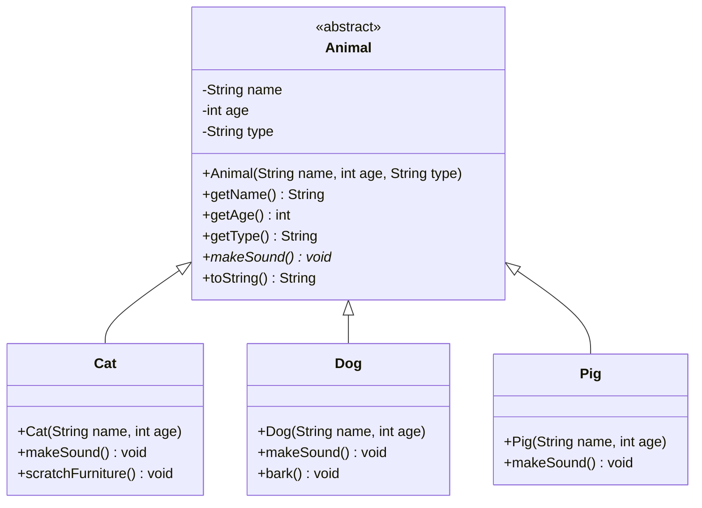

# L20 - [In-class] Polymorphism and interfaces example

 [CMPINF 0401] Java examples covering **inheritance, abstract classes, polymorphism, type checks/downcasting**, and **interfaces with default methods**.

## Contents

| File | Content |
| --- | --- |
| `src/Animal.java` | Abstract base class with private fields, a `final` field, getters, an abstract `makeSound()` method, and `toString()` |
| `src/Cat.java` | Subclass that calls `super(...)`, overrides `makeSound()`, and adds its own method (`scratchFurniture()`) |
| `src/Dog.java` | Subclass that overrides `makeSound()` using inherited getters, and adds its own method (`bark()`) |
| `src/Pig.java` | Subclass that only overrides `makeSound()` (no extra methods) |
| `src/Zoo.java` | `main` that creates a cat, a dog, and a pig and runs the same code on each. Shows dynamic binding, `instanceof` pattern matching, explicit downcasting, and a pattern-matching `switch` |
| `src/CarDemo.java` | `Engine` and `Battery` interfaces with `default` methods, and a `Car` class that implements `Cloneable` and overrides `clone()` |

## Class diagram



How to read the diagram:

- **`<<abstract>>`** means `Animal` can't be instantiated (`new Animal(...)` won't compile). It exists only to be extended.
- **Hollow-triangle arrows** (`<|--`) mean `extends`: `Cat`, `Dog`, and `Pig` **are** `Animal`s and inherit its fields and methods.
- **`*` after a method** (`makeSound()*`) marks it as abstract. Every concrete subclass must override it. That's why each subclass lists its own `makeSound()`.
- **`-` / `+`** mean `private` / `public`. The subclasses can't access `name` directly; they call `getName()` instead.
- `type` is also `final` in the code (set once in the constructor). Mermaid has no symbol for that.

## Things to try

- In `Zoo.java`, switch from `runAnimalBehavior` (if/else + `instanceof`) to `runAnimalBehavior2` (pattern-matching `switch`) and compare.
- In `Zoo.java`, rewrite `createAnimal` with a `switch` instead of if/else.
- In `CarDemo.java`, follow the TODO: make `Car` implement both `Engine` and `Battery`. Both define a default `start()`, so `Car` must override `start()` and can call `Engine.super.start()` and/or `Battery.super.start()` inside it.

## Running

The project uses the default VS Code Java layout: sources are in `src/`, compiled classes are in `bin/`.

**In VS Code:** open the folder with the *Extension Pack for Java* installed, then click **Run** above `main` in `Zoo.java` or `CarDemo.java`.

**From the terminal** (Java >= 22, needed for the unnamed pattern `case Dog _` in `Zoo.java`):

```bash
javac -d bin src/*.java
java -cp bin Zoo
java -cp bin CarDemo
```

## License

[MIT](LICENSE)
